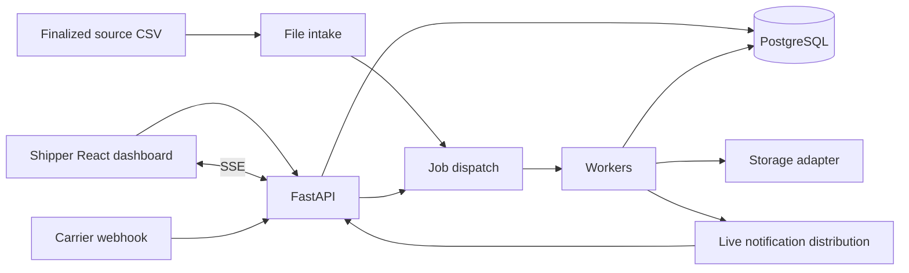

# System Architecture

## Components
| Component | Responsibility |
|---|---|
| React + Vite frontend | Shipper dashboard, table preferences, forms, Search and SSE toasts |
| FastAPI | Authentication/authorization, query/metrics APIs, creation, webhook receipt and export acceptance |
| PostgreSQL | Companies/users, customers, shipments/events/images, mapping and durable import/job/error state |
| Redis | Background dispatch, transient cache/live notification distribution as selected by implementation |
| Workers | File adapters, carrier events, pending-image storage and CSV export |
| Scheduler/file intake | Independently configurable source polling and safe import claims |
| Storage adapters | Local files/dummy URLs now; future public S3 uploads |
| Alembic and seed CLI | Schema lifecycle and separate repeatable development data population |

## Tenant boundary
MVP portal scope is verified user.company_id=shipments.shipper_company_id. A shipper sees packages across its carriers. Carrier ingestion is authenticated independently, resolves account to shipper and matches the assigned shipment. Administrator role changes area-management permission, not tenant scope.

The planned carrier dashboard uses carrier_company_id scope in phase 2. Do not enable it by accepting a client-selected tenant/company type in MVP.

## Ingestion and transactions
Source adapters translate Paychex/OnTrac layouts into shared domain commands. Shared services own authorization, normalization, reference upsert, dedupe, receipt order and transactions. Never put alternative shipment business rules into each provider loader.

Use durable PostgreSQL import/event/job state before acknowledging accepted asynchronous work. Worker delivery may repeat; canonical unique keys and guarded updates prevent duplicated effects. Immutable source receipts and error records remain separate from shipment_events.

## Read models and notifications
Start with PostgreSQL list and aggregate queries. Reduce event history to one current outcome/exception before counting shipments. Index and benchmark against representative synthetic data before adding derived stores. Elasticsearch is deferred.

Export readiness is durable job state; SSE is notification delivery, not canonical storage. Reconnection must recover ready jobs without regenerating CSV files or leaking another user's notifications.

## Local and future infrastructure
Use local sftp directories for imports/exports and a POD dummy-upload adapter. A real SFTP daemon, AWS account and notification provider are not prerequisites for local MVP development. Future S3 adapters retain the requested public-URL behavior.

Compose services are frontend, API, PostgreSQL, Redis, workers and scheduler/intake as needed. Do not add Elasticsearch to the default or optional Compose profile while deferred.

## Schema and bootstrap
Alembic owns schema migrations. A separate idempotent seed command creates required catalogs, Paychex/OnTrac and two Paychex development accounts. See [SEED_DATA.md](SEED_DATA.md). Migration execution must not silently create passwords or development users in production.

## Implemented P4 creation boundary
ShipmentService transactionally creates tenant-scoped immutable addresses, a shipment and one Created event; AccountMappingService retains historical carrier/account ownership independently of current service mappings. AreaService enforces current membership/administrator permissions. PostgreSQL guards/FKs enforce reference, address, assignment, route and number-reservation invariants. HTTP creation diagnostics are persisted separately from rejected business transactions. P7 adds file workers and ingestion receipts/retries; P8 adds carrier event/outcome maintenance. See CREATION_IMPLEMENTATION.md.

## Implemented P5 reads
QueryService uses PostgreSQL repeatable-read snapshots, tenant-scoped address/area joins and scalar latest-terminal/latest-action projections. Filtering, full-result Tracking metrics and stable pagination share the same population. Search spans history by one exact selected namespace; detail retrieves an authorized stable ID. P8 owns ingestion writes/current-field maintenance; P9 owns image selection and storage. See QUERY_IMPLEMENTATION.md.

## Implemented P6 workspace
React consumes typed, runtime-validated P4/P5 DTOs for Tracking, exact Search, stable-ID detail and administrator area controls. History navigation preserves typed lookup context and selected identity; company/user/role remounts and abortable reads prevent stale cross-workspace content. Existing cookie/CSRF transport supports PUT/DELETE area mutations. No new infrastructure/dependencies/migrations. See UI_IMPLEMENTATION.md.

## Implemented P7 intake
The optional Compose ingestion profile runs a combined scheduler/worker using PostgreSQL source locks, import/row checkpoints and per-field receipt guards. Restricted local snapshots and independent archive state recover filesystem/database interruptions. Shared creation is reused by the Paychex loader; trusted source/service assignment determines ownership. Redis is not a durable intake queue. See FILE_INGESTION_IMPLEMENTATION.md for transactions, limits, retry stages and operations.

## Implemented P8 carrier boundary
Raw-ID X-API-Key webhooks authenticate live integrations and synchronously commit receipts/events/errors. OnTrac CSV shares P7 file checkpoints and the same carrier service. Retained account ownership determines shipper scope; event-time/receipt reduction is separate from per-field last-receipt guards. Source-time provenance stabilizes normalization retries. P9 now supplies image preparation and independent storage retries. See CARRIER_INGESTION_IMPLEMENTATION.md.

## Implemented P9 POD boundary
Validated/resized prepared bytes and event-linked image metadata commit with accepted carrier effects in PostgreSQL. A separate optional pod-worker performs bounded, idempotent storage retries without replaying events, using per-image session locks and durable pre-I/O attempt counts. Detail selects image-bearing events by event-time/receipt order before readiness. The default storage adapter returns a deliberately dummy .invalid URL without network I/O. Real AWS remains deferred. See POD_IMPLEMENTATION.md.

## Implemented P10 dashboard
DayService reuses QueryService's verified shipper scope, repeatable-read snapshot, one-package population and metric expressions. PostgreSQL determines the UTC reporting day. Global metrics, latest-action exceptions and a grouped active-area left join share one response snapshot. The combined /v1/my-day DTO supplies React's My Day route; the approved three statistics routes remain available. No projection/cache, migration or dependency was added. See DASHBOARD_IMPLEMENTATION.md.

## Implemented P11 exports
PostgreSQL export_jobs durably records acceptance/effective dates, five-attempt worker state and artifact metadata. The optional exports profile runs a separate CSV worker with per-job session locks, server-side row streaming and atomic local publication before ready. A read-only API mount serves requester-authenticated downloads from sftp/download; the worker writes the same root. SSE polls/replays bounded durable requester snapshots with live token/membership rechecks. Redis remains support for existing authentication; no export pub/sub availability dependency is introduced. See EXPORT_IMPLEMENTATION.md.

## P12 verification and operation
The standalone compose.verification.yaml uses a separate logistics-p12 project/database/network/storage and synthetic fixtures. Real browser and controlled outage checks exercise the existing application without populating the development tenant. A generated disposable benchmark database measures PostgreSQL queries and streaming export. The trusted app.ops.cli command reports aggregate state only. Observable SSE heartbeats and a client liveness watchdog recover silently stalled streams; Uvicorn watches only application code and bounds graceful shutdown to five seconds. See P12_VERIFICATION.md and tasks/plan.md for evidence, repeatable commands and production limitations.
